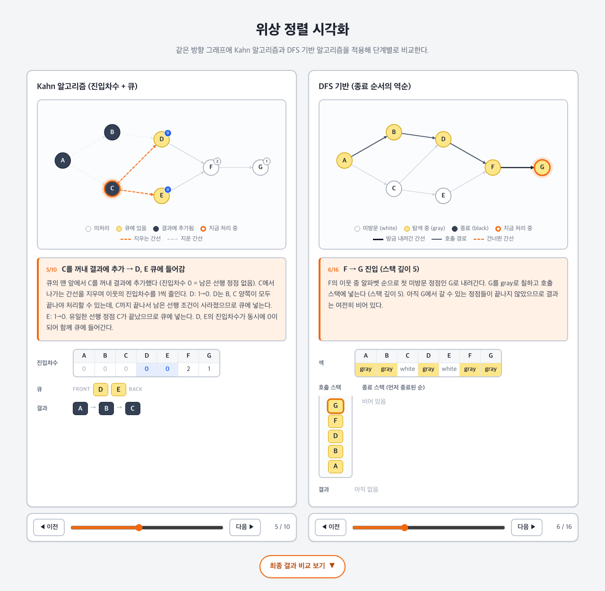

# 위상 정렬 시각화 (Topological Sort Visualizer)

같은 방향 비순환 그래프(DAG)에 **Kahn 알고리즘**과 **DFS 기반 알고리즘**을 적용해, 실행 과정을 단계별로 나란히 비교하는 웹앱입니다.

**배포 주소:** https://haeram7.github.io/topological-sort-viz/



## 개요

- 왼쪽은 Kahn 알고리즘(진입차수 + 큐), 오른쪽은 DFS 기반 알고리즘(종료 순서의 역순)입니다.
- 각 단계마다 그래프 상태, 자료구조(진입차수·큐 / 색·호출 스택·종료 스택), 그 단계에서 한 일을 함께 보여줍니다.
- 이 저장소는 **시각화 도구**입니다. 알고리즘에 대한 자세한 설명은 별도로 제출한 문서(PDF)에 있습니다.

## 예제 그래프

| 항목 | 내용 |
|---|---|
| 정점 | A, B, C, D, E, F, G |
| 간선 | A→B, A→C, B→D, C→D, C→E, D→F, E→F, F→G |
| Kahn 결과 | A B C D E F G |
| DFS 결과 | A C E B D F G (종료 순서 G F D B E C A의 역순) |

## 사용법

- **단계 이동:** 각 패널 아래의 `◀ 이전` / `다음 ▶` 버튼이나 슬라이더로 움직입니다. 두 패널은 서로 독립적으로 움직입니다.
- **최종 결과 비교:** 페이지 하단의 `최종 결과 비교 보기` 버튼을 누르면 두 결과와 간선별 검증 표가 펼쳐집니다.
- **특정 단계로 바로 열기:** URL에 `?kahn=5&dfs=6`처럼 단계 번호(1부터)를 붙이면 해당 단계 화면으로 바로 열립니다.
  - 예: https://haeram7.github.io/topological-sort-viz/?kahn=5&dfs=6

### 범례

| 표시 | Kahn | DFS |
|---|---|---|
| 흰색 정점 | 미처리 | 미방문 (white) |
| 노란색 정점 | 큐에 있음 | 탐색 중 (gray) |
| 진회색 정점 | 결과에 추가됨 | 종료 (black) |
| 주황 테두리 | 지금 처리 중 | 지금 처리 중 |
| 주황 점선 간선 | 이번 단계에 지우는 간선 | 이미 종료된 이웃이라 건너뛴 간선 |
| 흐린 점선 간선 | 이미 지운 간선 | — |
| 진한 실선 간선 | — | 현재 호출 경로 / 방금 내려간 간선 |
| 정점 옆 숫자 배지 | 현재 진입차수 (0이면 파란색) | — |

## 설계 포인트

- **미리 계산한 Step 배열:** 알고리즘의 전체 실행 과정을 처음에 한 번 `Step[]`으로 계산해 둡니다. 화면은 `steps[i]`를 그리기만 하는 순수 함수입니다. 단계 이동은 인덱스만 바꾸므로 같은 인덱스는 언제나 같은 화면이 됩니다.
- **그래프 라이브러리 없이 SVG 직접 작성:** d3 같은 라이브러리 없이 정점·간선·화살촉을 SVG로 직접 그립니다. 간선 양 끝을 원의 반지름만큼 줄여서, 화살촉이 원에 가려지지 않게 했습니다.
- **고정된 방문 순서:** 인접 정점을 알파벳 오름차순으로 정렬해 두어 실행 결과가 항상 같습니다.

## 프로젝트 구조

```
src/
├── data/graph.ts              예제 그래프 (정점 좌표, 간선, 인접 리스트)
├── algo/
│   ├── types.ts               Step 타입
│   ├── kahn.ts                Kahn 알고리즘 Step 생성
│   └── dfsTopo.ts             DFS 기반 위상 정렬 Step 생성
├── components/
│   ├── GraphView.tsx          SVG 그래프
│   ├── StatePanel.tsx         진입차수·큐 / 색·스택 / 결과 표시
│   ├── AlgoPanel.tsx          그래프 + 캡션 + 상태 패널 묶음
│   ├── StepControls.tsx       이전·다음·슬라이더
│   └── FinalComparison.tsx    최종 결과 비교
├── App.tsx                    좌우 비교 레이아웃
└── index.css                  스타일
```

## 로컬 실행

```bash
npm install
npm run dev      # http://localhost:5173/topological-sort-viz/
npm run build    # 프로덕션 빌드 (dist/)
```

## 기술 스택 및 배포

- React 19 + TypeScript + Vite
- GitHub Actions → GitHub Pages (`main` 브랜치에 push하면 자동 배포)
